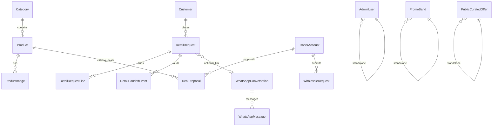

# Architecture — RARE OUD platform

## Stack

| Layer | Choice |
|-------|--------|
| App | Next.js 15 (App Router), React 19 |
| Data | PostgreSQL 16 + Prisma 6 |
| Auth | JWT in httpOnly cookies (`ro_admin_session`, `ro_trader_session`) |
| WhatsApp | Baileys worker (`worker/whatsapp-worker.ts`), optional `fake` adapter for E2E |
| Edge | Caddy reverse proxy + TLS (production compose) |
| i18n | Arabic default routes; `/en/*` rewrite + `ro_locale` cookie |

## Roles

| Role | Surface | Notes |
|------|---------|-------|
| Public | Storefront `/`, `/catalog`, `/product/*`, cart → request → wa.me | No accounts |
| Admin | `/admin/*` | Catalog, orders, traders, deals, wholesale, inbox |
| Trader | `/trader/*` | Deals, wholesale, profile; blocked from public `/offers` shell |

Middleware enforces portal separation and cross-role `/forbidden`.

## Prisma ERD (summary)

Core flows:

1. **Retail:** cart (client) → `/request` → `RetailRequest` + wa.me deep link + handoff events.
2. **Deals:** trader proposal → admin accept/reject → optional public curated offer.
3. **Wholesale:** trader wizard → admin fulfillment + carrier/tracking fields.
4. **WhatsApp:** worker persists conversations/messages; admin inbox links to orders.

## Key directories

| Path | Purpose |
|------|---------|
| `app/(storefront)/` | Public pages |
| `app/admin/`, `app/trader/` | Portals |
| `lib/catalog/` | Product queries & media |
| `lib/admin/ui-hidden.ts` | Hide regression fixtures in UI |
| `content/legal/` | Markdown legal stubs (E5) |
| `prisma/` | Schema + seeds |
| `worker/` | WhatsApp background process |

## Deployment unit

- **Web:** Next standalone/server via Docker `web` service.
- **Worker:** separate container sharing DB + `.wa-auth` volume.
- **Postgres + backup sidecar:** see `docker-compose.prod.yml`.

Detailed ops: `RUNBOOKS/deploy.md` and `docs/pro-readiness/VPS-RUNBOOK.md`.
