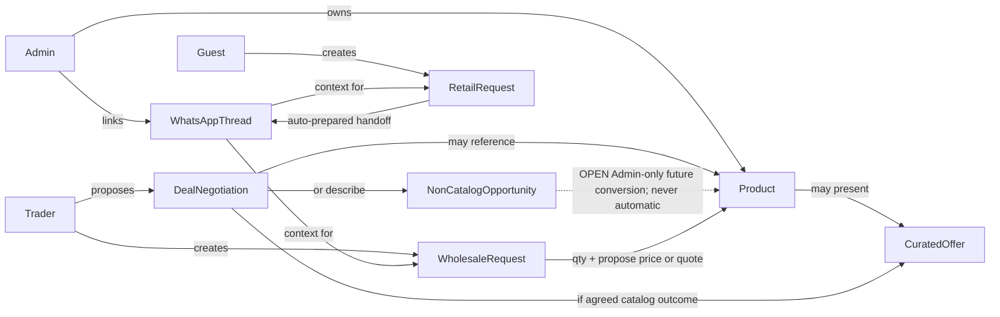

# Week 1 — Site Information Architecture

**Surfaces:** Public storefront · Trader portal (deals + wholesale) · Admin panel (incl. WhatsApp inbox)  
**Principle:** One brand publicly (RARE OUD); role-separated private tools; no trader storefronts.  
**Revision:** Updated for negotiation deals, non-catalog opportunities, wholesale quote/propose-price, bilingual IA, single admin, shipping method shell (pricing deferred).

---

## 1. Sitemap (logical)

```text
PUBLIC (Guest / optional Customer)
├── Home
├── Catalog (browse / search / filters)
│     categories: String musical instruments | Accessories
├── Product Detail
├── Offers / Curated offers          ← agreed catalog offers only, RARE OUD identity
├── Cart
├── Request checkout (WhatsApp handoff)   ← auto-prepared message; no payment
│     includes: destination country (Syria or outside Syria)
│               + destination-dependent shipping method shell
│               (availability/charges DEFERRED — no rate engine)
├── About / Contact (lightweight)
└── Optional: Customer account (orders/profile)  [Assumption A-03 — still OPEN]

TRADER PORTAL (authenticated Trader)
├── Sign in / Registration / Pending approval state
├── Dashboard (status summary — deals + wholesale only)
├── Propose deal
│     path A: related to catalog product
│     path B: non-catalog opportunity description
│             (does NOT auto-create/publish a catalog product)
├── My deals / negotiations (Under review | Counter-terms | Agreed | Closed*)
├── Deal negotiation detail (proposal + RARE OUD responses / history)
├── Wholesale catalog
├── Submit wholesale request (qty + propose price OR request quote)
├── My wholesale requests (+ tracking)
└── Notifications / status center

ADMIN PANEL (authenticated Admin — ONE user at launch)
├── Dashboard (ops overview)
├── Catalog management (products, 2 categories, media, prices)
├── Traders (onboarding, approval, status; classification new/regular when defined)
├── Deal negotiation queue / workspace
├── Retail requests / orders
├── Wholesale fulfillment (incl. quotation response when requested)
├── Customers (if accounts enabled)
├── WhatsApp conversations inbox (unified)
├── Request ↔ conversation linking
└── Basic settings (light; NO multi-staff management as launch feature)
```

\*Final negotiation closure state names: **OPEN** — “Closed” used as planning placeholder only.

---

## 2. Navigation models

### 2.1 Public storefront

**Primary nav:** Home · Catalog · Offers · Contact  
**Utility:** Search · Cart · **Language (AR | EN)** · Account (optional) · Trader login link (secondary, not hero)

**Plain language:** The public site is one RARE OUD house. Language switch is first-class. Trader tools stay quiet — not a marketplace of sellers.

### 2.2 Trader portal

**Primary nav:** Overview · Propose deal · My deals · Wholesale · My wholesale requests · Notifications  
**No nav items for:** inventory, sales reports, commissions, “my products”, public seller shop.

### 2.3 Admin panel

**Primary nav:** Overview · Catalog · Traders · Deals · Retail requests · Wholesale · Inbox · Customers · Settings  
**Inbox** remains first-class.  
**Launch operator model:** single Admin account — settings do not include staff-role management as v1 scope.

---

## 3. Access control matrix

| Area | Guest | Customer | Trader (pending) | Trader (approved) | Admin (×1 launch) |
|------|-------|----------|------------------|-------------------|-------------------|
| Browse catalog / PDP / offers | ✓ | ✓ | ✓ | ✓ | ✓ |
| Cart + WhatsApp request | ✓ | ✓ | ✓* | ✓* | ✓* |
| Optional account area | — | ✓ | — | — | — |
| Propose / negotiate deals | — | — | — | ✓ | negotiate all |
| View own deals | — | — | limited | ✓ | all |
| Wholesale submit | — | — | — | ✓ | — |
| Admin catalog/ops | — | — | — | — | ✓ |
| WhatsApp inbox | — | — | — | — | ✓ |
| See trader identity on deals | — | — | own only | own only | ✓ |

\*Whether a Trader may also place retail requests as a shopper is **OPEN / NOT LOCKED**. Do not design a special Trader retail workflow. Public retail remains guest/customer-friendly; the platform does not currently forbid a trader from being a shopper unless the client later decides otherwise.

---

## 4. Object relationships (IA view)



---

## 5. Page inventory by surface

### 5.1 Storefront pages

| ID | Page | Purpose | Key content |
|----|------|---------|-------------|
| SF-01 | Home | Brand + entry | Hero brand, one line, CTAs, dominant image |
| SF-02 | Catalog | Find products | Filters: category (String / Accessories), price, curated offer |
| SF-03 | Product Detail | Evaluate one product | Media, specs, price / curated offer terms, add to cart |
| SF-04 | Offers | Curated active offers | RARE OUD identity only — serious, not flash-sale |
| SF-05 | Cart | Review line items | Qty, prices, continue |
| SF-06 | Request form | Contact + shipping shell | Name, phone, notes, **destination country** (Syria or outside Syria), **destination-dependent shipping methods** (examples not universal); customer may see available + selected method; **charges DEFERRED** |
| SF-07 | Handoff confirmation | Auto WhatsApp prep | Reference + Open WhatsApp (message prefilled) |
| SF-08 | Static info | Trust/contact | Minimal |

**Filter note:** No public “by trader” filter.

### 5.2 Trader portal pages

| ID | Page | Purpose | Structural change vs prior |
|----|------|---------|----------------------------|
| TR-01 | Auth / register | Create trader access | Unchanged intent |
| TR-02 | Pending state | Waiting for approval | Unchanged |
| TR-03 | Overview | Deals + wholesale summary | Status labels → negotiation language |
| TR-04 | Propose deal | Dual path: catalog **or** non-catalog opportunity + conditions; non-catalog does not create products | **Updated** |
| TR-05 | My deals board | Negotiation list/filters | **Updated** (no Rejected-primary tabs) |
| TR-06 | Deal negotiation detail | Proposal + RARE OUD counter-terms / history | **Updated** |
| TR-07 | Wholesale catalog | Eligible products (no fixed price list assumed) | **Updated** |
| TR-08 | Wholesale request form | Qty + propose price **or** request quote | **Updated** |
| TR-09 | My wholesale requests | Status + tracking | Unchanged intent |
| TR-10 | Notifications | Deal/wholesale status center | Unchanged intent |

### 5.3 Admin pages

| ID | Page | Purpose | Structural change vs prior |
|----|------|---------|----------------------------|
| AD-01 | Dashboard | Ops snapshot | Unchanged intent |
| AD-02 | Products list/edit | Catalog CRUD | Categories locked to 2 |
| AD-03 | Categories | String instruments, Accessories | **Confirmed set** |
| AD-04 | Traders list/detail | Approve traders; later: new/regular classification | Classification rules OPEN |
| AD-05 | Deal negotiation queue | Active negotiations | **Updated** (not approve/reject queue) |
| AD-06 | Deal negotiation workspace | Accept / respond with different terms / continue / close | **Updated** |
| AD-07 | Retail requests | Status management | Shipping method recorded; costs deferred |
| AD-08 | Wholesale fulfillment | Confirm, quote response, ship, tracking | **Updated** |
| AD-09 | Customers | If accounts exist | Still optional/OPEN |
| AD-10 | WhatsApp inbox | Unified conversations | Single admin operator at launch |
| AD-11 | Conversation detail | Thread + linked request | Unchanged intent |
| AD-12 | Settings | Light config | **No staff-user management** as launch feature |

---

## 6. URL / section naming (localization-ready)

| Section | Suggested path prefix |
|---------|----------------------|
| Storefront | `/`, `/catalog`, `/product/[id]`, `/offers`, `/cart`, `/request` |
| Trader | `/trader/...` |
| Admin | `/admin/...` |
| Locale | prefix or cookie/header strategy TBD in build — both AR and EN required |

**Avoid:** `/vendor/shop/[traderId]`.

---

## 7. Content priority & IA decisions (plain language)

1. Brand before marketplace cues.  
2. Offers are **curated RARE OUD commercial presentations**, not trader storefronts or bargain racks.  
3. Trader portal is a **negotiation + wholesale request workspace**.  
4. Admin is the operational heart — with **one** operator at launch.  
5. WhatsApp is part of IA; retail message is **auto-prepared**.  
6. Wholesale is trader-only.  
7. Shipping methods are destination-dependent and may differ between Syria and countries outside Syria. Exact availability, shipping charges, and packaging charges are deferred pending client confirmation — **no rate engine** in Week 1 IA.

---

## 8. Cross-surface consistency rules

- Same product naming/imagery everywhere.  
- Public never shows trader as seller.  
- Shared negotiation vocabulary across trader + admin (not Rejected-primary).  
- Request reference IDs in admin, wholesale views, and WhatsApp handoff text.  
- Full **RTL (AR)** and **LTR (EN)** mirroring for all surfaces.

---

## 9. Assumptions used in this IA

- A-03 Optional customer area kept as optional branch.  
- A-05 Offers in primary nav + quiet catalog markers.  
- A-06 Arabic default + English available.  
- Negotiation list uses planning labels Under review / Counter-terms / Agreed / Closed* (*OPEN).  
- Single shared inbox operated by the one Admin (extensible later without building staff management now).

## 10. Unresolved client decisions affecting IA

See also Discovery §9 Open / Deferred:

- Non-catalog deal operational workflow / any future Admin-only catalog conversion (**OPEN** — not a designed Week 1 feature; never automatic).  
- In-platform vs WhatsApp negotiation channel.  
- New vs regular trader classification UI fields.  
- Shipping method availability matrix and price display (none until rules exist).  
- Customer accounts keep/remove.  
- Final negotiation state machine labels.  
- Whether Traders may place retail requests as shoppers (**OPEN / NOT LOCKED**).

**Scope clarification required (if demanded later):** a dedicated Admin “create catalog product from non-catalog deal” tool — do not add silently; never a Trader Create Product flow.

---

## Stage 2 summary (revised)

**Decided:** Three surfaces; dual-path deal proposal (non-catalog ≠ auto product); negotiation workspace; wholesale propose-price/quote; bilingual nav; single admin; destination-dependent shipping method shell without rates (Syria + outside Syria); categories String + Accessories.  
**Assumptions:** Optional accounts; curated Offers nav; planning negotiation labels.  
**Open/Deferred:** Non-catalog ops/conversion path, negotiation channel, new/regular rules, shipping availability/pricing, WA template, closure states, trader-as-shopper.  
**Plain-language takeaway:** Shoppers see one bilingual RARE OUD store that can ship to Syria and beyond once destination rules exist. Traders negotiate opportunities and request wholesale. One admin runs the control room.

---

## 11. As-built sitemap alignment (2026-10-18)

Logical IA in §1 is **still the contract**. Implemented App Router paths (high level):

| Area | Implemented routes | Delta vs Week 1 IA |
|------|-------------------|-------------------|
| Storefront | `/`, `/catalog`, `/product/[slug]`, `/offers`, `/cart`, `/request`, `/contact`, `/privacy` (+ `/en/*`) | Home layout richer than wireframe SF-01; optional customer accounts **not** built |
| Trader | `/trader/login`, `/trader`, `/trader/deals`, `/trader/deals/new`, `/trader/deals/[id]`, `/trader/wholesale`, `/trader/wholesale/requests`, `/trader/wholesale/[id]`, `/trader/offers`, `/trader/profile`, `/trader/notifications` | Matches dual-path deals + wholesale; wizard UX not extracted |
| Admin | `/admin/login`, `/admin`, `/admin/inbox`, `/admin/requests`, `/admin/deals`, `/admin/wholesale`, `/admin/products`, `/admin/categories`, `/admin/offers`, `/admin/customers`, `/admin/customers/[id]`, `/admin/traders` | Categories: **two launch categories** edit-only; promos gated behind flag |
| System | `/forbidden`, `not-found`, health `api/health` | Cross-role 403 present |

**Wireframe → route mapping:** [06-wireframe-to-route-map.md](./06-wireframe-to-route-map.md)  
**Owner assets still blocking polish:** [../pro-readiness/OWNER-ASSETS.md](../pro-readiness/OWNER-ASSETS.md)
