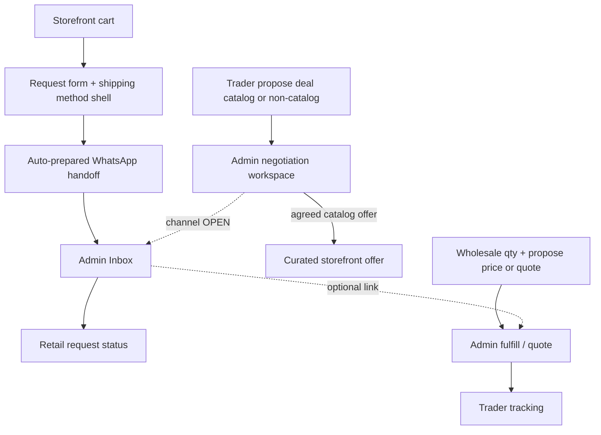

# Week 1 — UI/UX Wireframes

**Format:** Structural wireframes (boxes/flow) for client review — not high-fidelity mockups.  
**Surfaces required:** (1) Storefront (2) Trader deals board (3) WhatsApp conversations inbox (4) Wholesale request flow  
**No payment steps. No trader storefronts. No invented shipping rates.**  
**Revision:** Negotiation (not reject-primary); dual-path deals; wholesale propose price / request quote; shipping method shell; bilingual utility; curated offer language.

Visual styling tokens: `04-brand-aligned-visual-design.md`.

---

## Wireframe conventions

```text
[=======]  primary action
(.......)  secondary action
{{.....}}  system / status message
#ID       screen reference
→         next step
```

Mobile: brand → content → CTA stacked. Desktop: readable content width; admin/trader list+detail.

---

# SURFACE 1 — Public storefront

## SF-01 Home

```text
+------------------------------------------------------------------+
| RARE OUD     Catalog  Offers  Contact     🔍  Cart  AR|EN        |
+------------------------------------------------------------------+
|                                                                  |
|   RARE OUD                                                       |
|   [one short premium line]                                       |
|   [======= Browse instruments =======]  (.... View offers ....)  |
|                                                                  |
|   [ full-bleed atmospheric product imagery plane ]               |
|                                                                  |
+------------------------------------------------------------------+
| footer: contact · trader access (quiet) · language               |
+------------------------------------------------------------------+
```

**UX decision:** No floating sale stickers, countdown bars, or seller logos on the hero.

---

## SF-02 Catalog

```text
+------------------------------------------------------------------+
| RARE OUD                              🔍 ........   Cart  AR|EN  |
+------------------------------------------------------------------+
| Filters            |  Results                                    |
| Category           |  +------------+  +------------+             |
|  □ String          |  |  image     |  |  image     |             |
|  □ Accessories     |  |  Name      |  |  Name      |             |
| Price              |  |  price     |  |  price     |             |
| Curated offer □    |  |  [Offer]†  |  |            |             |
|                    |  +------------+  +------------+             |
+------------------------------------------------------------------+
```

†Quiet typographic marker only — never “SALE”, never trader name, never loud discount colors.

---

## SF-03 Product detail

```text
+------------------------------------------------------------------+
| ← Catalog                                                        |
| +-------------------+   Product name                             |
| | media gallery     |   Price / curated offer terms (if any)     |
| | images + video    |   Conditions (serious, concise)            |
| +-------------------+   Specs                                    |
|                         Qty [ - 1 + ]                            |
|                         [======= Add to request cart =======]    |
|                         {{ Fulfilled by RARE OUD }}              |
+------------------------------------------------------------------+
```

---

## SF-05 → SF-06 → SF-07 Cart & WhatsApp request (auto-prepared)

```text
CART
+------------------------------------------------------------------+
| Your request cart                                                |
| Item · qty · unit · line                                         |
| Subtotal (products)                                              |
| {{ Shipping & packaging charges are destination-dependent and    |
|    deferred — not calculated on this screen }}                   |
| [======= Continue =======]                                       |
+------------------------------------------------------------------+
                         ↓
REQUEST DETAILS
+------------------------------------------------------------------+
| Conceptual flow:                                                 |
| Country → destination-dependent methods → details → WhatsApp     |
|                                                                  |
| Name*                                                            |
| Phone* (WhatsApp-capable)                                        |
| Destination country*  (Syria or a country outside Syria)         |
|                                                                  |
| Shipping method*                                                 |
| {{ Methods shown are those configured/available for the          |
|    selected destination — not a universal list for every country.}}|
|   Example method types (availability varies by destination):     |
|   ○ Air consolidation                                            |
|   ○ Land consolidation                                           |
|   ○ Aramex                                                       |
|   ○ Postal service                                               |
|   ○ Hand delivery                                                |
| Customer may see: available method(s) + selected method          |
| Customer does NOT see calculated shipping/packaging prices here  |
|                                                                  |
| City / area / address notes                                      |
| Notes                                                            |
| {{ Shipping methods are destination-dependent and may differ     |
|    between Syria and countries outside Syria. Exact availability,|
|    shipping charges, and packaging charges are deferred pending  |
|    client confirmation. No rate engine implied. }}               |
| Optional account checkbox (only if accounts enabled)             |
| [======= Send request via WhatsApp =======]                      |
+------------------------------------------------------------------+
                         ↓
HANDOFF
+------------------------------------------------------------------+
| Request reference: RO-2026-0042                                  |
| {{ Your complete request was prepared automatically.             |
|    Continue in WhatsApp — no need to retype the order. }}        |
| [======= Open WhatsApp =======]  ← prefilled message             |
| (.... Back to catalog ....)                                      |
+------------------------------------------------------------------+
```

**WhatsApp content minimum (template text OPEN):**  
reference, products, qty, prices/subtotals, total if available, name, phone, notes, destination country, selected shipping method (when chosen), other contact/shipping info. **Do not imply shipping/packaging cost calculation in Week 1 or Week 2** unless separately scoped later.

---

# SURFACE 2 — Trader deals board (negotiation)

## TR-05 My deals / negotiations

```text
+------------------------------------------------------------------+
| RARE OUD Trader          Overview  Deals  Wholesale  Alerts      |
+------------------------------------------------------------------+
| My commercial deals                [======= Propose deal =======]|
| Filters: All | Under review | Counter-terms | Agreed | Closed*   |
|------------------------------------------------------------------|
| Status         Subject                 Latest terms     Updated  |
| Under review   Catalog: Oud Type A     Proposed …       today    |
| Counter-terms  Non-catalog opportunity RARE OUD reply…  1d       |
| Agreed         Catalog: Accessory B    Agreed terms…    3d       |
|------------------------------------------------------------------|
| click row → Negotiation detail                                   |
| {{ Shoppers never see your name as a seller }}                   |
+------------------------------------------------------------------+
```

\*“Closed” and exact lifecycle labels = **OPEN** (planning placeholder).  
**Removed:** Rejected-primary tabs; “edit & resubmit after reject” as core UX.

---

## TR-04 Propose deal (dual path)

```text
+------------------------------------------------------------------+
| Propose a commercial deal                                        |
|                                                                  |
| Deal relates to:                                                 |
|  ( ) A product in the RARE OUD catalog                           |
|        [ Search & select catalog product ............ ]          |
|  ( ) An opportunity not currently listed in the catalog          |
|        Title / description _______________________________       |
|        Specs / references / media notes (optional) _______       |
|        {{ This does NOT create, publish, or modify a catalog     |
|           product. RARE OUD/Admin retains full control of any    |
|           future catalog creation. Conversion workflow: OPEN }}  |
|                                                                  |
| Commercial terms & conditions (serious, clear)                   |
|   Proposed price / commercial structure: ________________        |
|   Quantity / volume conditions (if any): ________________        |
|   Timing / validity notes (if any): ____________________         |
|   Other commercial conditions: _________________________         |
|   Message to RARE OUD: _________________________________         |
|                                                                  |
| {{ RARE OUD controls whether and how this proceeds.              |
|    This starts a negotiation — not an automatic listing. }}       |
| [======= Submit proposal =======]                                |
+------------------------------------------------------------------+
```

**UX decision:** Do not invent an advanced promotion engine (no coupon builder, BOGO wizard, etc.).  
**Invariant:** Non-catalog deal ≠ catalog product. No Trader “Create Product,” no automatic catalog creation/publication.  
**OPEN:** exact ops path if Admin later converts a non-catalog opportunity into a catalog product (not designed in Week 1).

---

## TR-06 Deal negotiation detail

```text
+------------------------------------------------------------------+
| Deal #D-184 · Under review / Counter-terms / …                   |
| Subject: [Catalog product name] OR [Non-catalog opportunity]     |
|------------------------------------------------------------------|
| Timeline / history                                               |
|  • You proposed: terms A                                         |
|  • RARE OUD responded: different price/terms B                   |
|  • You replied: …                                                |
|------------------------------------------------------------------|
| Your next response (when applicable)                             |
|   [ text / updated terms ]                                       |
|   [======= Send response =======]                                |
|                                                                  |
| {{ Negotiation channel (fully in-platform vs WhatsApp): OPEN }}  |
| (.... Continue on WhatsApp ....)  ← optional if later confirmed  |
| {{ Public identity remains RARE OUD if offered on the store }}   |
+------------------------------------------------------------------+
```

---

## AD-05 / AD-06 Admin deal negotiation workspace

```text
+------------------------------------------------------------------+
| Deal negotiations                                                |
| Queue: needs response | waiting on trader | agreed | closed*     |
| Trader · Subject · Latest terms · Updated · [Open]               |
+------------------------------------------------------------------+
| Workspace                                                        |
| History thread (proposal + counters)                             |
| Actions:                                                         |
|  [======= Accept current terms =======]                          |
|  [ Respond with different price/terms ]                          |
|  [ Continue discussion ]                                         |
|  [ Close opportunity ]   ← final states OPEN                     |
| Notes (internal)                                                 |
| If catalog-related public offer:                                 |
|  □ Present as curated RARE OUD offer (when agreed)               |
+------------------------------------------------------------------+
```

**UX decision:** Primary verbs = accept / respond with different terms / continue / close — **not** Reject (+ mandatory reason) as the model.  
Conflict of multiple public offers on same catalog product (if still relevant operationally): admin-controlled; no auto-winner — keep as ops caution, not a flash-sale race.

---

# SURFACE 3 — WhatsApp conversations inbox (Admin)

## AD-10 Unified inbox

```text
+------------------------------------------------------------------+
| ADMIN · Inbox                          (single Admin at launch)  |
+------------------------------------------------------------------+
| Filters: All | Unlinked | Retail | Wholesale | Unread            |
| +----------------------+----------------------------------------+|
| | Search threads       |  Contact name / phone                  ||
| |----------------------|  Request: RO-2026-0042 (linked)        ||
| | ● Sara · RO-0042     |----------------------------------------||
| |   last msg preview   |  Message bubbles                       ||
| | ○ Dealer Levant      |----------------------------------------||
| |   wholesale WH-019   |  [ Link to request ▾ ]                 ||
| | ○ Unknown +963...    |  Reply composer                        ||
| |                      |  [======= Send =======]                ||
| +----------------------+----------------------------------------+|
+------------------------------------------------------------------+
```

**UX decisions:**  
- One Admin operates the inbox at launch (architecture may stay extensible; no staff-management UI).  
- Linking panel mandatory.  
- One WhatsApp Business number.  
- Live sync = Week 4.

---

# SURFACE 4 — Wholesale request flow

## End-to-end

```text
TRADER                         ADMIN
TR-07 Wholesale catalog        AD-08 Fulfillment / quotation
TR-08 Submit request             ↓
TR-09 Track + shipping info    Status + tracking
```

## TR-07 Wholesale catalog

```text
+------------------------------------------------------------------+
| Wholesale catalog                                                |
| {{ Pricing varies by quantity — not a fixed public price list }} |
| Product | Notes | [ Request ]                                    |
+------------------------------------------------------------------+
```

## TR-08 Submit wholesale request

```text
+------------------------------------------------------------------+
| Wholesale request                                                |
| Product(s) / lines                                               |
| Quantity*                                                        |
|                                                                  |
| Pricing approach*                                                |
|  ( ) I propose a price: ________                                 |
|  ( ) Request a quotation from RARE OUD                           |
|                                                                  |
| {{ If you are a new trader, a minimum quantity may apply         |
|    per product. Regular traders: no minimum.                     |
|    Exact new/regular rules & MOQ values: OPEN }}                 |
|                                                                  |
| Notes · delivery contact / address                               |
| [======= Submit request =======]                                 |
| {{ No online payment }}                                          |
+------------------------------------------------------------------+
```

## TR-09 My wholesale requests

```text
+------------------------------------------------------------------+
| My wholesale requests                                            |
| WH-019 | qty… | Quote/proposed… | Status | Tracking              |
+------------------------------------------------------------------+
```

## AD-08 Wholesale fulfillment

```text
+------------------------------------------------------------------+
| Wholesale fulfillment                                            |
| Trader (visible here) · lines · qty · proposed price or “quote”  |
| If quote requested: [ Provide quotation / terms ]                |
| Status: New → Confirmed → Preparing → Shipped → Closed           |
| Shipping: carrier · tracking # · date · notes                    |
| [======= Save =======]                                           |
| (.... Open WhatsApp thread ....) if linked                       |
+------------------------------------------------------------------+
```

---

## Cross-surface interaction map



---

## Accessibility & responsive notes

- AR RTL + EN LTR mirroring for nav, forms, chat bubbles.  
- Mobile inbox = list → thread drill-in.  
- Shipping method list must remain readable; only show methods configured for the selected destination when rules exist; do not imply all example methods are always available.  
- Avoid countdown timers and aggressive urgency patterns on offers.

---

## Assumptions vs confirmed in wireframes

| Item | Status |
|------|--------|
| Auto-prepared WhatsApp message | Confirmed intent; template OPEN |
| Shipping methods destination-dependent (Syria + outside Syria); examples not universal | Structure reserved; **availability + charges DEFERRED**; no rate engine |
| Dual-path deal proposal | Confirmed |
| Negotiation actions (accept / counter / continue / close) | Confirmed direction; closure states OPEN |
| Wholesale propose price OR request quote | Confirmed |
| New vs regular MOQ behavior | Concept confirmed; definition/values OPEN |
| Language switcher AR\|EN | Confirmed |
| One Admin | Confirmed |
| Optional customer account checkbox | Still OPEN |
| Reject reason + resubmit | **Removed** |

---

## Stage 3 summary (revised)

**Decided:** Storefront bilingual + curated offers; retail flow Country → destination-dependent methods → details → WhatsApp (charges deferred; Syria + international capable); auto WhatsApp prep; trader negotiation board (not reject-primary); dual-path propose deal with non-catalog ≠ auto product; wholesale qty + propose/quote; single-admin inbox.  
**Open/Deferred:** Non-catalog conversion workflow, negotiation channel, new/regular rules, MOQ values, shipping availability/pricing, WA template, final closure states, trader-as-shopper.  
**Plain-language takeaway:** Screens support serious commercial conversation with RARE OUD — not bargain checkouts or seller shops.

---

## As-built mapping (2026-10-18)

Wireframe IDs above are **structural intent**. For screen-by-screen routes, conformance marks, and known DEVIATES (e.g. home H1–H9 vs current `/`), use:

- [06-wireframe-to-route-map.md](./06-wireframe-to-route-map.md)
- [../ui-planning/plan/CONFORMANCE.md](../ui-planning/plan/CONFORMANCE.md) (Parts 03–05)
